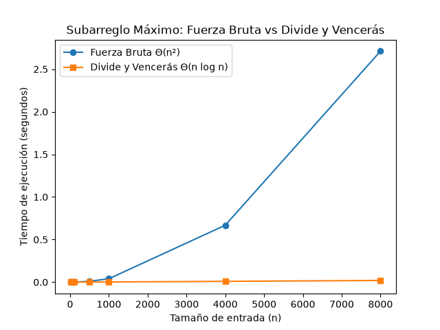

# Laboratorio 2 - Dividir y Vencer

**Nombre completo:** Santiago Gomez Montoya
**Curso:** Análisis de Algoritmos

## Cómo reproducir esto

1. Activar el entorno virtual: `..\..\venv\Scripts\activate`
2. Correr las pruebas: `python pruebas.py`
3. Generar la gráfica: `python medicion.py`

---

## Parte 1 - Implementación y pruebas

Para comprobar que las dos versiones daban lo mismo armé un `pruebas.py` con varios `assert`. Probé la serie de los 8 días (tiene que dar 17), un solo elemento, una lista toda negativa, otra toda positiva, un caso donde la mejor racha cruza justo por el medio y 20 listas aleatorias. En todos, la fuerza bruta y el divide y vencerás dieron exactamente la misma suma.

**Código:** [subarreglo.py](subarreglo.py) | [pruebas.py](pruebas.py)

---

## Parte 2 - Medición y gráfica

Medí con `time.perf_counter()`. Como el computador siempre mete algo de ruido, repetí cada medición un par de veces. Los datos salen de una semilla fija (42), así el profe puede generar las mismas listas que yo (los tiempos exactos sí le pueden variar según su máquina). Los tamaños fueron 10, 50, 100, 500, 1000, 4000 y 8000.

**Código:** [medicion.py](medicion.py)

---

## Parte 3 - Análisis

### 1. La recurrencia

Para `subarreglo_maximo` la recurrencia es `T(n) = 2T(n/2) + Θ(n)`. El `2T(n/2)` sale de partir el problema en dos mitades (izquierda y derecha) de tamaño n/2, y el `Θ(n)` es lo que cuesta `suma_cruzada`, que recorre desde el medio hacia los dos lados.

Con el método maestro: a = 2, b = 2 y f(n) = Θ(n). Como `n^(log₂ 2) = n`, f(n) crece igual que eso, así que es el **Caso 2** y `T(n) = Θ(n log n)`.

La fuerza bruta es Θ(n²) por los dos ciclos anidados: el de afuera va de 0 a n-1 y el de adentro de i hasta n-1. Al sumar `n + (n-1) + ... + 1` da n(n+1)/2, que es cuadrático.

### 2. Lo que medí vs. lo que esperaba

En la gráfica la diferencia se nota de una: la línea azul (fuerza bruta) se dispara y la naranja (divide y vencerás) queda casi pegada al cero.

Cuando paso de 4000 a 8000, o sea que n se duplica, la fuerza bruta sube de unos 0.6 s a 2.6 s, es decir que se multiplica por 4.3. Eso cuadra con Θ(n²), donde al duplicar n el tiempo debería multiplicarse por 4. El divide y vencerás casi ni se mueve, lo cual tiene sentido porque n log n crece mucho más despacio.

### 3. ¿Y en tamaños pequeños?

En mis mediciones el divide y vencerás ganó incluso con n = 10, así que no encontré ningún punto donde la fuerza bruta fuera mejor. Mi explicación es que las llamadas recursivas cuestan poco comparadas con el doble ciclo de la fuerza bruta. Eso sí, con tamaños tan chicos las diferencias son de microsegundos, y ahí el ruido del computador puede pesar bastante.

### 4. ¿Cuándo vale la pena dividir?

Si pensamos en buscar el máximo de un arreglo, dividirlo a la mitad no sirve de nada. Recorrerlo una vez ya es Θ(n). Si lo partimos, la recurrencia queda `T(n) = 2T(n/2) + Θ(1)`, que por el método maestro también da Θ(n), o sea lo mismo. Combinar solo cuesta comparar los dos máximos (Θ(1)), pero las llamadas recursivas agregan un costo extra que no se compensa con nada.

En el subarreglo máximo la historia es distinta: dividir sí ayuda, porque manejar el caso cruzado permite pasar de Θ(n²) a Θ(n log n).

### 5. Concepto para la gerente

Yo le recomendaría a la cooperativa usar **divide y vencerás**. Con una serie de 1.000.000 de registros la fuerza bruta se demoraría muchísimo porque es Θ(n²), mientras que el divide y vencerás, al ser Θ(n log n), lo resolvería bastante más rápido.

Para hacerme una idea, usé la forma de la curva y no una regla de tres: con 8000 registros la fuerza bruta tardó ~2.6 s, y 1.000.000 es 125 veces más datos, así que el tiempo se multiplicaría por 125², unas 15.625 veces. Eso da más de 11 horas. Con divide y vencerás el tiempo crecería mucho más suave, y estimo que quedaría en menos de un minuto. **Aclaro que esto es una estimación, no una medición real.**
