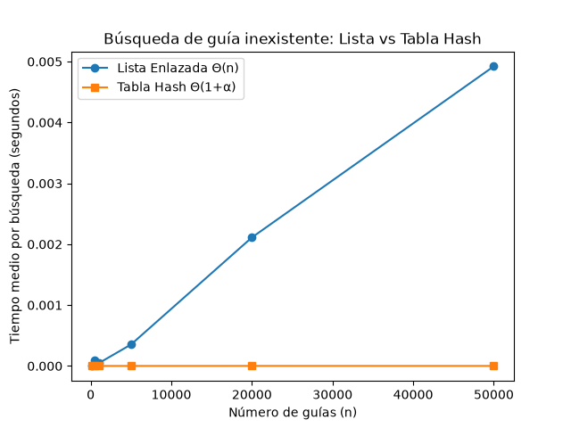
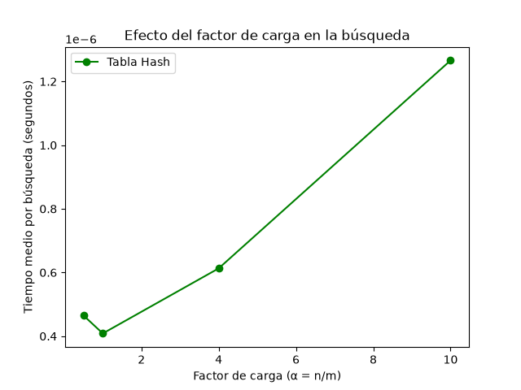

# Laboratorio 3 - Estructuras de Datos

**Nombre completo:** [Santiago Gomez Montoya]
**Curso:** Análisis de Algoritmos

## Cómo reproducir esto

1. Activar el entorno virtual: `..\..\venv\Scripts\activate`
2. Correr las pruebas: `python pruebas.py`
3. Generar las gráficas: `python medicion.py`

---

## Parte 1 - Implementación y pruebas

Para armar esto, implementé una lista enlazada sencilla y una tabla hash con encadenamiento. Para verificar que todo funcionara, hice el archivo `pruebas.py` con varios `assert`. Probé búsquedas que sí existen y búsquedas que no (para ver que devuelvan `None`), forcé la colisión con m=7 (usando las guías 10, 24 y 17, que caen todas en la casilla 3) y revisé que el factor de carga diera 3/7. También probé con 20 colecciones aleatorias para confirmar que la lista y la tabla siempre devuelven el mismo estado.

**Código:** [estructuras.py](estructuras.py) | [pruebas.py](pruebas.py)

---

## Parte 2 - Medición y gráficas

Para el primer experimento usé tamaños de 100, 500, 1000, 5000, 20000 y 50000 guías. En cada uno, la tabla tenía un número de casillas primo cercano a n/2 (para que el factor de carga quedara alrededor de 2). Hice 200 búsquedas de guías que no existen y saqué el promedio. Para el segundo experimento fijé n=20000 y fui variando el factor de carga (α) en 0.5, 1, 4 y 10. Usé una semilla fija (42) para que los resultados se puedan repetir.

**Código:** [medicion.py](medicion.py)

---

## Parte 3 - Análisis

### 1. Costo teórico

Buscar en la lista enlazada cuesta Θ(n) porque, si la guía no existe, toca recorrer todos los nodos hasta el final. En cambio, en la tabla hash el costo promedio es Θ(1 + α), donde α es el factor de carga (n/m). El "1" es lo que cuesta calcular el hash y entrar a la casilla, y el "α" es lo que cuesta recorrer la listita de esa casilla. Todo esto asume que la función hash reparte las claves de forma pareja (hashing uniforme). Si todas las guías cayeran en la misma casilla, la tabla se volvería una lista y el costo sería Θ(n), perdiendo toda la ventaja.

### 2. Lo medido contra lo esperado

En la primera gráfica se nota clarísimo: la línea de la lista sube como una recta, mientras que la de la tabla está pegada al cero. Si comparo n=20000 con n=50000 (2.5 veces más datos), el tiempo de la lista se multiplica por un factor cercano a 2.5, que coincide con Θ(n). La tabla casi ni se mueve, confirmando Θ(1). En la segunda gráfica, a medida que α crece, el tiempo de la tabla sube un poquito (de ~0.45 a ~1.25 microsegundos), lo cual cuadra con Θ(1 + α).

### 3. Explique las colisiones

Una colisión pasa cuando dos guías distintas dan el mismo resultado en la función hash y caen en la misma casilla. Pasa incluso si hay más casillas que guías, porque el hash puede mandar varias claves al mismo lugar. El encadenamiento lo resuelve guardando una lista enlazada en cada casilla (ahí se meten todas las que caigan). Su ventaja es que es fácil de implementar y aguanta factores de carga mayores a 1; su costo es la memoria extra de los nodos. El direccionamiento abierto, en cambio, busca otra casilla libre dentro de la misma tabla. Su ventaja es que no gasta memoria extra, pero puede formar aglomeraciones y el factor de carga no puede pasar de 1. En el ejemplo, con m=7, las guías 10, 24 y 17 caen en la casilla 3 porque el residuo de dividir entre 7 da 3 en los tres casos.

### 4. Tabla hash o árbol de búsqueda

Para el monitoreo por rango ("guías entre X y Y"), la tabla hash **no sirve**, porque no guarda ningún orden entre las claves. Para eso toca usar un árbol de búsqueda binario, que sí permite recorrer las claves en orden y sacar rangos rápido. Si las 400.000 guías llegaran ya ordenadas y se insertaran una por una en un árbol sin balanceo, el árbol se degeneraría en una lista (altura 400.000) y haría Θ(n) comparaciones, igual que la lista. En cambio, un árbol equilibrado tendría altura Θ(log n) ≈ 19, con ese orden de comparaciones.

### 5. Concepto para la jefa de operaciones

Yo le recomendaría a la jefa usar una **tabla hash con encadenamiento** para la consulta puntual del call center, y complementarla con un **árbol de búsqueda binario** (o un índice ordenado) para el monitoreo por rango. Con 5.000.000 de envíos, una búsqueda en la lista tardaría muchísimo (Θ(n)), mientras que en la tabla sería casi instantánea (Θ(1+α)). Haciendo una estimación con base en mis mediciones: si con 50.000 guías la lista tardó ~0.005 segundos por búsqueda, al pasar a 5.000.000 (100 veces más datos), el tiempo se multiplicaría por 100 (porque es lineal), dando ~0.5 segundos por búsqueda. En la tabla, el tiempo se mantendría casi constante si el factor de carga se controla. **Aclaro que esto es una estimación, no una medición directa.**